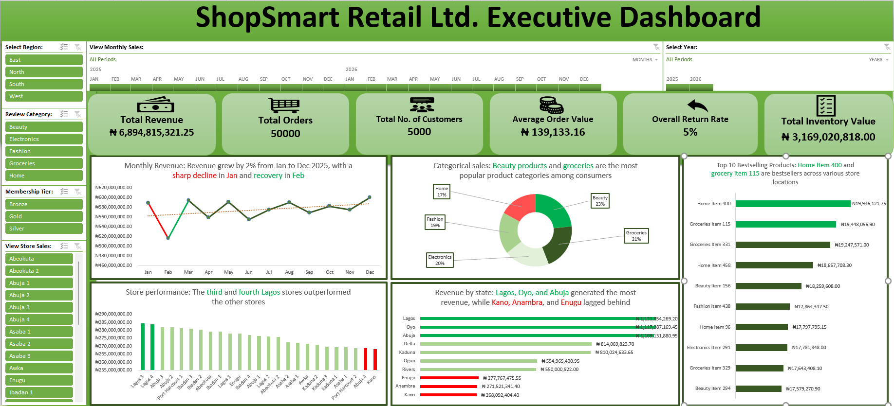

# ShopSmart Retail Ltd. Sales Analysis

## Project Overview

This project was completed as part of the AnalystLab Africa Data Analytics Internship.

The objective was to analyze ShopSmart Retail Ltd.'s sales, inventory, customer, and returns data to identify business insights and support data-driven decision-making, identifying:

-Sales trends
-Inventory shortages
-Product return patterns
-Store performance

## Business Objectives

- Identify sales fluctuations throughout the year
- Determine inventory shortages across store locations
- Assess product return rates and their causes
- Evaluate store performance

## Business Questions
Which product generated the highest revenue?
Which stores performed best?
Which product categories sold the most?
Which stores experienced inventory shortages?
Which products had the highest return rates?

## Tools Used
-Microsoft Excel
-Pivot Tables
-Pivot Charts
-XLOOKUP
-Data Cleaning and Validation
-Dashboard Design
-Business Reporting

## Data Analysis Process

### Data Preparation
- Combined multiple CSV datasets into a single workbook
- Cleaned and validated data
- Established relationships between tables using XLOOKUP

### Analysis
- Monthly revenue trend analysis
- Product performance analysis
- Store performance analysis
- Inventory availability assessment
- Return rate analysis

### Reporting
- Designed an executive dashboard
- Created a business report
- Generated actionable business insights and recommendations

## Key Findings

- Revenue increased by 2% during 2025.
- Beauty products contributed 23% of total revenue.
- Southern region stores generated 32% of total revenue.
- Kaduna stores experienced the highest inventory shortages.
- Beauty and Home products recorded the highest return rates.

## Recommendations

- Increase marketing efforts in underperforming regions.
- Improve inventory management in high-shortage stores.
- Ensure best-selling products remain adequately stocked.
- Investigate late deliveries contributing to product returns.

## Project Files

- ShopSmart_Retail_Analysis.xlsx
- ShopSmart Retail_Executive_Dashboard.pdf
- ShopSmart Retail_Business Report.pdf

## Skills Demonstrated

- Data Cleaning
- Data Validation
- Data Analysis
- Dashboard Development
- KPI Design
- Business Intelligence
- Data Visualization
- Data Storytelling
- Business Reporting

## Author

Tessy Odiley

## Internship Program

AnalystLab Africa Data Analytics Internship
